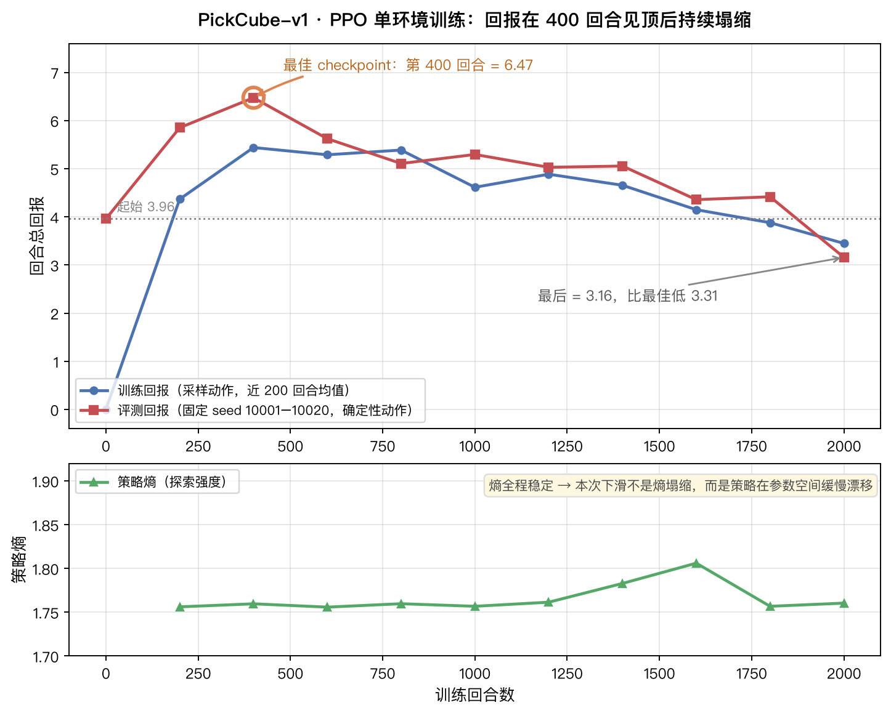

# ManiSkill 学习记录 · 从第 3 章实践到手写强化学习

> 跟着《具身智能仿真实战》第 3 章学具身智能仿真：把书里的代码手打一遍，
> 然后在 `PickCube` 任务上**从零手写实现了 REINFORCE → Actor-Critic → PPO** 三种强化学习算法。
>
> 记录完整训练过程、踩过的坑，以及一个诚实的结论：**在单环境 CPU 仿真上，抓取成功率始终是 0%**。



---

## 这个仓库里有什么

```
book/       # 《具身智能仿真实战》第 3 章的代码实践
├── ch3-1-3_pick_cube.py                # 3.1.3 快速入门：创建环境、跑随机动作
├── ch3-3-1_open_storage_drawer.py      # 3.3 自己搭一个「打开储物柜抽屉」任务（手打 + 逐行注释）
├── open_cabinet_drawer.py              # 内置抽屉任务的源码副本（对照用）
├── run_my_drawer.py                    # 运行上面那个自定义任务
├── my_pick_cube_env.py                 # 继承 PickCubeEnv，只改机器人初始位姿
└── run_my_pick_cube_env.py             # 运行自定义 PickCube 环境

rl/         # 强化学习实验（这个仓库的重点）
├── step1_env.py              # 环境封装 + 随机策略基线
├── step2_policy.py           # 高斯策略网络（μ + σ）
├── step3_reinforce.py        # REINFORCE
├── step4_evaluate.py         # 固定评测集（关键！）
├── step5_actor_critic.py     # Actor-Critic（加 baseline）
├── step6_ppo.py              # PPO（GAE + clip + 多轮更新）
└── step7_train_with_ckpt.py  # 早停 + 最佳 checkpoint

results/    # 训练曲线与原始数据
```

**说明**：教材正文与图片不在本仓库；代码是手写的，AI 负责讲解概念、帮我定位 bug、以及给样板代码参考。

---

## 环境与安装

```bash
# Python 3.11（3.14 太新，ManiSkill 装不上）
python3.11 -m venv .venv && source .venv/bin/activate
pip install -r requirements.txt
```

⚠️ **macOS 用户**：Apple Silicon 上只能跑 **CPU 仿真**（`num_envs=1` 时 ManiSkill 自动选 `physx_cpu`）。
实测约 **2100 步/秒**（无渲染）。

---

## 快速开始

```bash
# ---------- 书本练习 ----------
cd book
python ch3-1-3_pick_cube.py          # 3.1.3 示例（会弹窗，需要 Vulkan）
python run_my_drawer.py              # 我搭的抽屉任务（⚠️ 需要 URDF 资产，见下方说明）

# ---------- 强化学习实验 ----------
cd ../rl
python step1_env.py                  # 1) 随机策略基线（约 5 秒）
python step2_policy.py               # 2) 验证策略网络输出
python step3_reinforce.py            # 3) REINFORCE（500 回合，约 1 分钟）
python step6_ppo.py                  # 4) PPO（500 回合，约 2 分钟）
python step7_train_with_ckpt.py      # 5) 带早停的完整训练（2000 回合，约 3 分钟）
```

> ⚠️ `run_my_drawer.py` 依赖的抽屉 URDF 资产来自 `storage1.ucsd.edu`，该服务器从 2026-09 起不可达
> （上游 [issue #1489](https://github.com/mani-skill/ManiSkill/issues/1489) 至今未修），所以这个脚本目前跑不了。

---

## 强化学习实验结果

| 算法 | 训练前回报 | 训练后回报 | 提升 | 成功率 |
|---|---|---|---|---|
| 随机策略（基线） | 2.03 ± 0.99 | — | — | 0% |
| Actor-Critic | 1.28 | 1.99 | ×1.55 | 0% |
| **PPO** | 1.36 | **5.78** | **×4.25** | 0% |

**回报能涨 4 倍，但抓取成功率一直是 0%。**

原因不是算法写错了，而是**样本量差了 2–3 个数量级**：

| | 本项目 | 这类任务常见规模 |
|---|---|---|
| 并行环境 | 1 | 256 – 4096 |
| 总采样步数 | 2.5 万 – 50 万 | 1000 万 – 1 亿 |
| 见过的"成功"样本 | 1 – 5 次 | 成千上万次 |

### 三种算法的核心区别

| | REINFORCE | Actor-Critic | PPO |
|---|---|---|---|
| **权重来源** | 整回合回报 `G_t` | 优势 `A = G − V(s)` | 优势（GAE 估计） |
| **数据利用** | 每回合更新一次就扔 | 同左 | **同一批数据训练 4 遍** |
| **稳定性机制** | 无 | 优势标准化 | **比率裁剪** + 梯度裁剪 + 熵正则 |
| **实测提升** | 训练回报 4.4 | 评测 ×1.55 | 评测 **×4.25** |

一句话：REINFORCE 告诉你"这局打得好"，Actor-Critic 告诉你"这步比预期好多少"，PPO 再加一条"别改太猛"。

---

## 踩过的坑（这部分可能比结果更有用）

### 1. 短训练会掩盖数值不稳定

训练到 2000 回合后，网络参数全部变成 `NaN`：

```
ValueError: Expected parameter loc ... but found invalid values: tensor([[nan, ...]])
```

**定位**：`log_std` 没有上下界，长时间训练被优化器推到极端值，`exp(log_std)` 溢出 → 采样出 `inf` → 梯度 `NaN`。

**修复**（4 层保护）：

```python
model.log_std.data.clamp_(-20.0, 2.0)          # ① 参数硬性截断
if not torch.isfinite(loss):                    # ④ 发现 NaN 就跳过这一步
    opt.zero_grad(); continue
lr = 1e-4                                       # ② 降低学习率
entropy_coef = 0.005                            # ③ 降低熵系数
```

修复后 10000 回合内 **NaN 事件 0 次**。

### 2. 策略塌缩：训练越久反而越差

2000 回合训练，每 200 回合评测一次：

| 回合 | 0 | 200 | **400** | 600 | 1000 | 1600 | 2000 |
|---|---|---|---|---|---|---|---|
| 评测回报 | 3.96 | 5.85 | **6.47** | 5.62 | 5.29 | 4.36 | **3.16** |

**回报在 400 回合见顶，之后一路掉到比起点还低。**

这里有个反直觉的点：这次塌缩**不是**熵太低导致的（熵全程稳定在 1.76），而是
**优势归一化把噪声放大了** → 参数在损失平面的平坦区域里随机漂移。

> 优势归一化 `adv = (adv - mean) / std` 的初衷是让学习率稳定，
> 但当优势本身已经接近 0（回报趋同）时，`/std` 会把 0.01 的噪声放大成 ±1 的"假信号"。

### 3. 同一套代码，两次结果差 15 倍

| 实验 | 配置 | 2000 回合后评测回报 |
|---|---|---|
| A | 相同超参 | **0.45** |
| B | 相同超参 | **6.57** |

**单环境 RL 的方差极大** —— 单次实验的结论不可信，必须固定评测集 + 多次重复。

### 4. 训练过程中的"成功率"不能信

50 回合里碰巧成功 1 次 → 显示 2%。但那 500 回合里总共只成功过 **1 次**。

所以另外建了 `rl/step4_evaluate.py`：
- 用 **20 个训练阶段没用过的种子**（10001–10200）
- 动作取均值（不采样），降低方差
- `torch.no_grad()`

---

## 我学到了什么

1. **代理指标会骗人**：回报涨 ≠ 任务成功（dense reward 里"靠近方块"也有分）
2. **小样本的百分比不可信**：1/50 = 2%，但置信区间宽到没有意义
3. **评测集必须和训练集分开**，否则你连"变好还是变差"都不知道
4. **不报错的 bug 最危险**：`clamp(action, -1, -1)` 不报错，但把所有动作都压成 -1
5. **探索是学得动的唯一来源**：σ 消失 = 失明

---

## TODO

- [ ] GPU 并行仿真（`num_envs ≥ 256`），补上样本量
- [ ] 模仿学习预热：脚本专家生成示范轨迹 → 监督学习 → PPO 微调
- [ ] 熵系数调度 + 最小熵约束，缓解塌缩
- [ ] 域随机化：物体位置、摩擦、光照

---

## 参考

- [ManiSkill 3 文档](https://maniskill.readthedocs.io/)
- PPO: [Schulman et al., 2017](https://arxiv.org/abs/1707.06347)
- GAE: [Schulman et al., 2015](https://arxiv.org/abs/1506.02438)
- REINFORCE: [Williams, 1992](https://link.springer.com/article/10.1007/BF00992696)

## License

MIT
